# TV test 20261125-215248

- App version: **1.0.2**
- Device: Xiaomi MIBOX3 9
- Result: **2 FAILED**

```
PASS  connected to 192.168.1.221:5555
INFO  device: Xiaomi MIBOX3 9
PASS  TV reaches DHAKA-FLIX 172.16.50.7
PASS  TV reaches DHAKA-FLIX 172.16.50.14
PASS  TV reaches DHAKA-FLIX 172.16.50.12
PASS  TV reaches DHAKA-FLIX 172.16.50.10
PASS  install
INFO  installed version: 1.0.2
PASS  app still running at the end (pid 7102)
PASS  no crashes
PASS  no ANRs
PASS  no player/runtime errors
INFO  video decoder: MediaCodec: [OMX.amlogic.hevc.decoder.awesome]
FAIL  screen 03_home_35s looks empty (45636 bytes)
PASS  screen 07_title_page has content
PASS  screen 16_search_friends has content
PASS  screen 20_category_grid has content
FAIL  screen 22_series_page looks empty (42341 bytes)

Screens to eyeball: 03 home, 07 title page (title visible, sizes in MB/GB), 16 'friends' (Friends series first),
17 'fri' suggestions row, 22 series page (seasons + episodes).
```

Files: [summary.txt](summary.txt) · [logcat.txt.gz](logcat.txt.gz) · [crash.txt](crash.txt) · [app_errors.txt](app_errors.txt)

## Screenshots

**01_home_10s**


**02_home_20s**

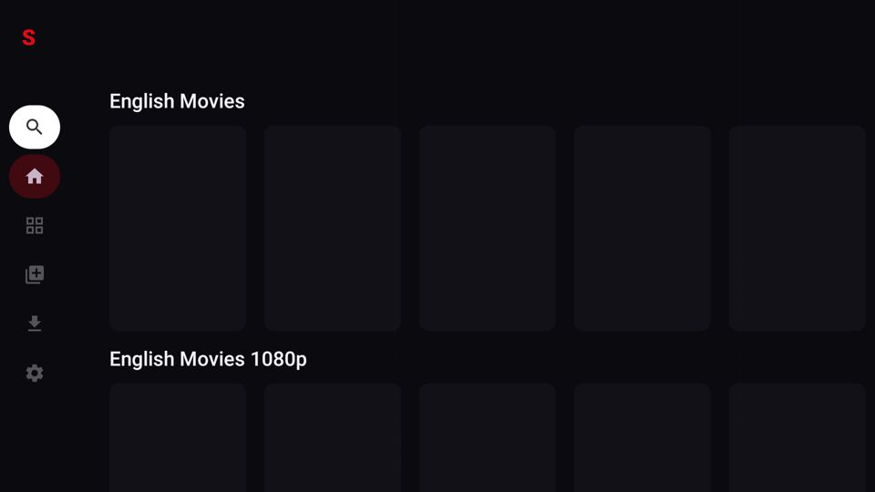

**03_home_35s**

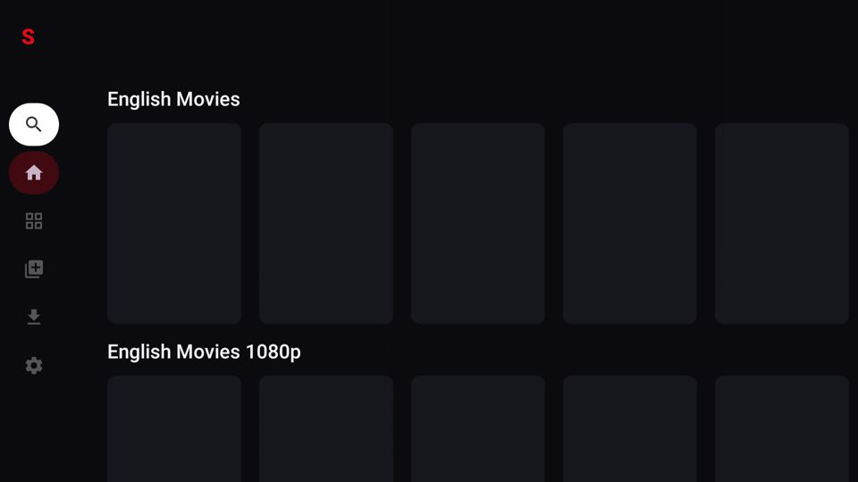

**04_row1**

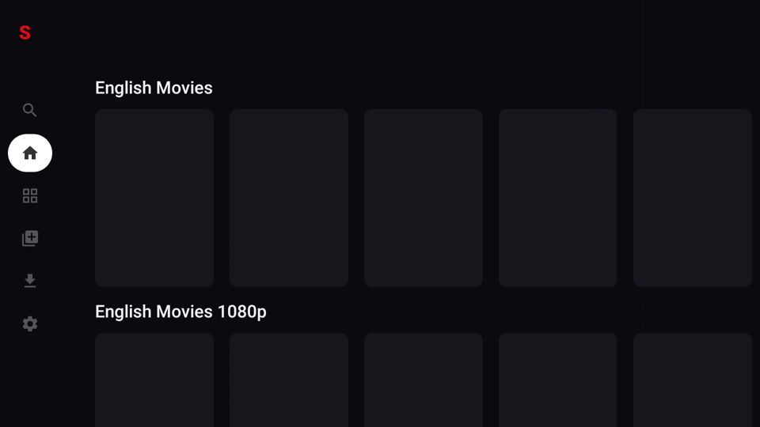

**05_row2**

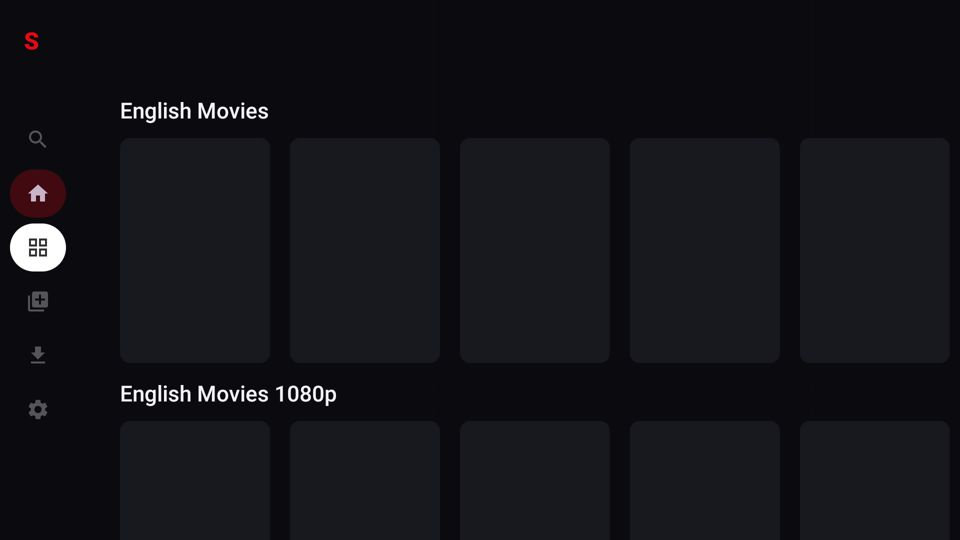

**06_row2_right**

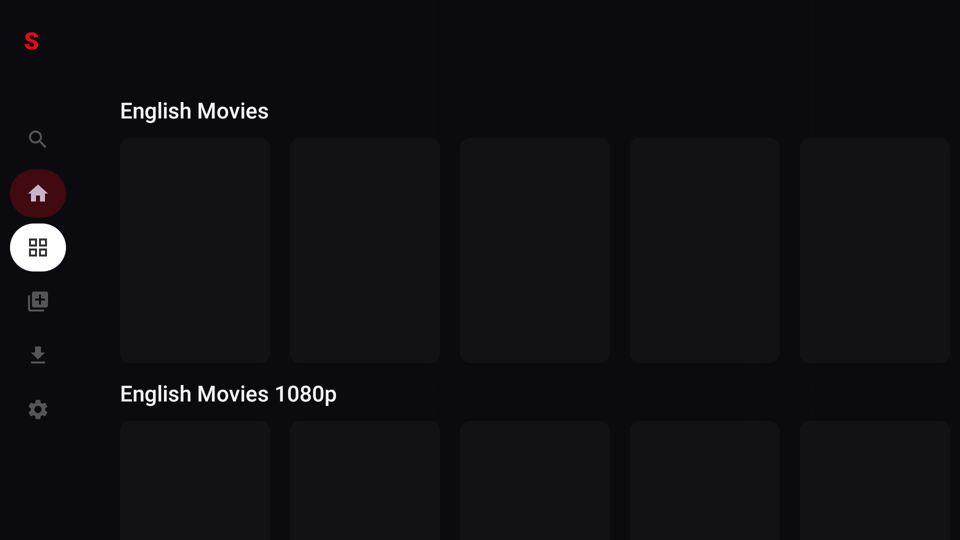

**07_title_page**


**08_player**

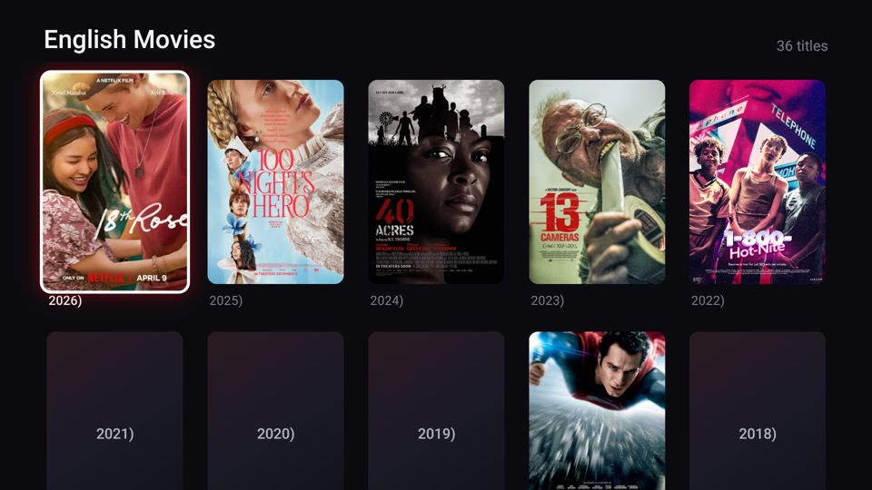

**09_player_controls_hidden**

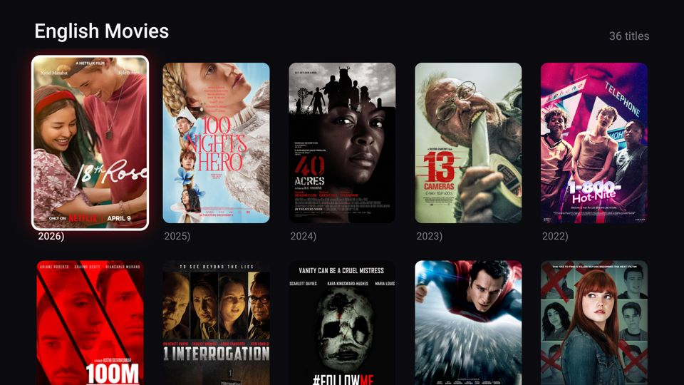

**10_seek_right**


**11_controls**

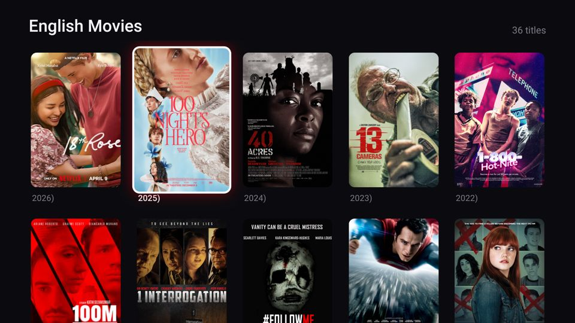

**12_back_on_title**


**13_back_home_focus**


**14_rail**

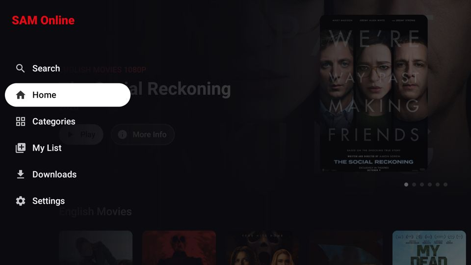

**15_search**


**16_search_friends**

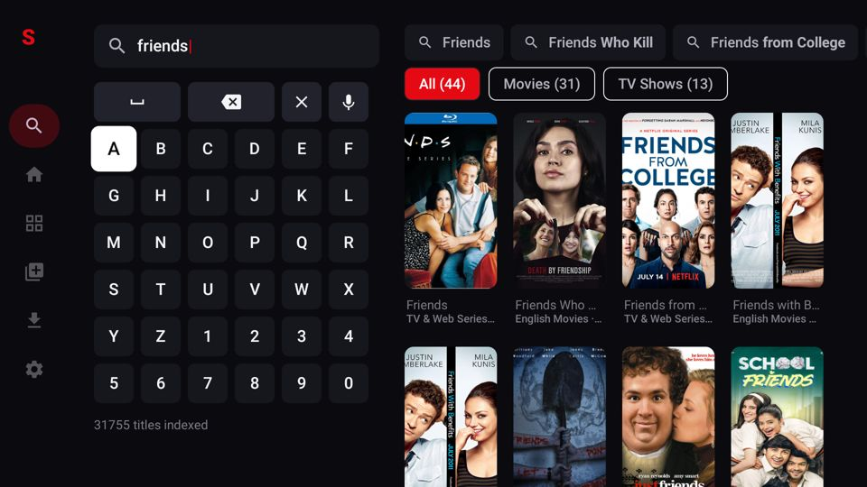

**17_search_fri_suggestions**

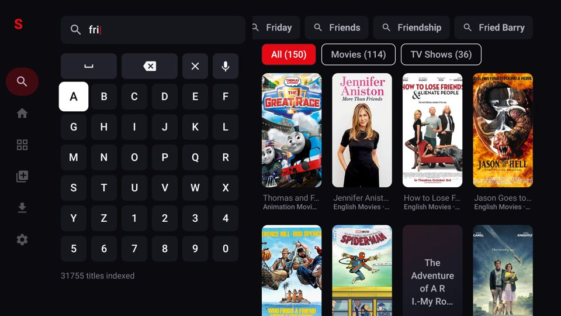

**18_categories**

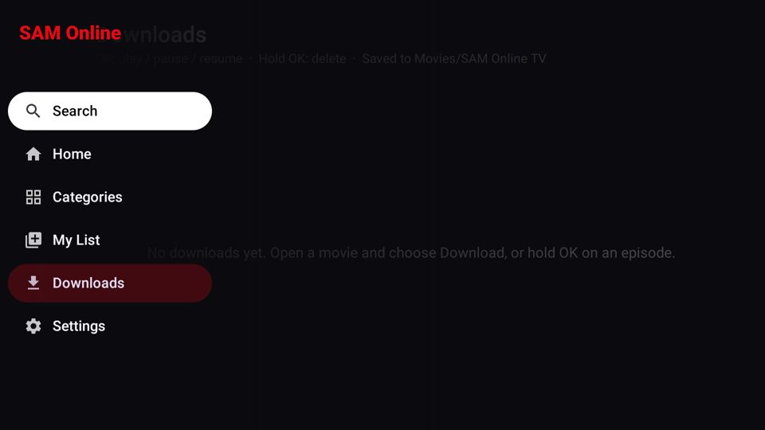

**19_categories_focus**

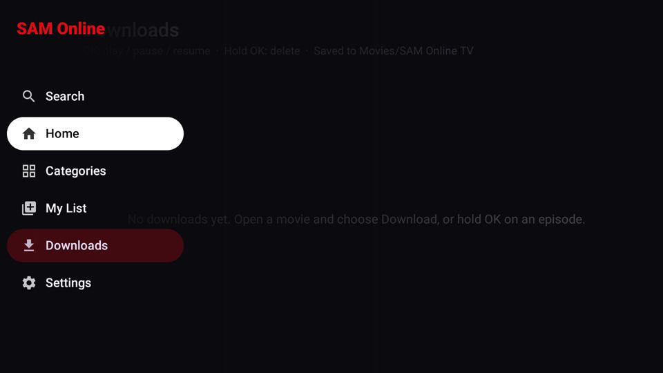

**20_category_grid**


**21_group_grid**


**22_series_page**


